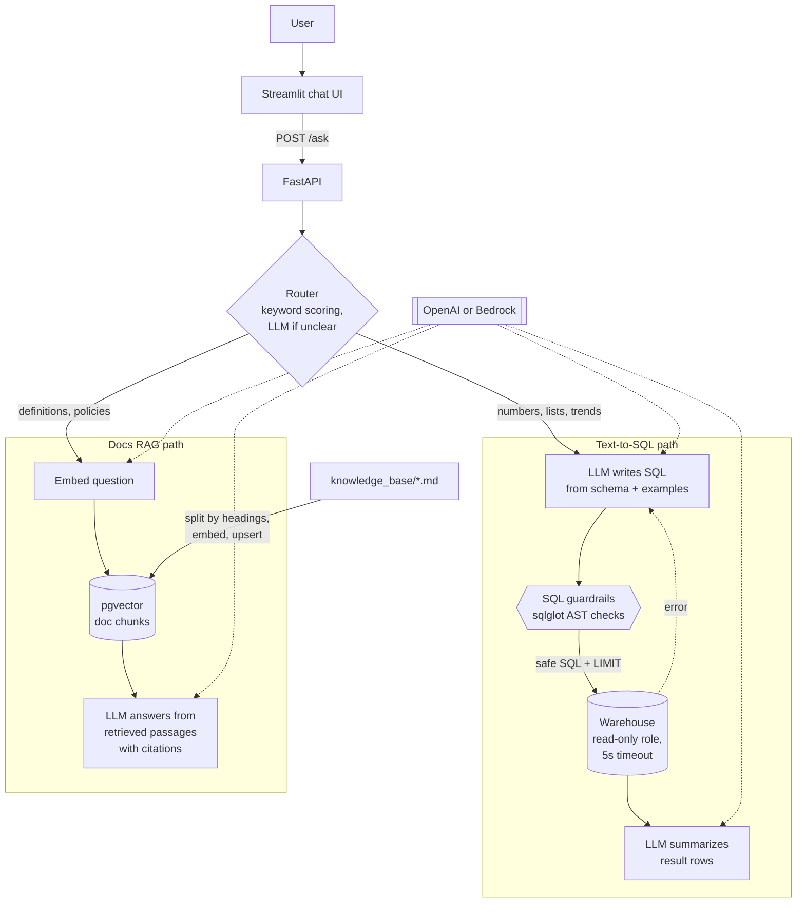

# GenAI Data Assistant (RAG and Text-to-SQL)

An assistant that answers business questions in plain English. Questions that need numbers ("top 5 products by revenue last quarter") are turned into SQL, checked by guardrails and run against the warehouse with a read-only role. Questions about meaning ("how is average order value defined?") are answered from the data documentation with retrieval augmented generation over pgvector, with citations. An evaluation harness measures routing accuracy, SQL execution accuracy and RAGAS scores so prompt and model changes can be compared.

Works with **OpenAI** or **Amazon Bedrock** (Claude + Titan embeddings) by changing one environment variable.


## Architecture



## Why the SQL is safe to run

LLM output is untrusted input, so there are three independent layers:

1. **AST guardrails** (`app/sql_guard.py`): the query must parse as exactly one PostgreSQL statement and be a read query. Any INSERT, UPDATE, DELETE, DDL, SELECT INTO, SET or GRANT is rejected, every table (including those in subqueries) must be on the allowlist, dangerous functions like `pg_sleep`, `pg_read_file`, `dblink` and `set_config` are blocked, and a `LIMIT` is added or capped.
2. **Read-only database role** (`sql/init/03_roles.sql`): `assistant_ro` only has SELECT on the `analytics` schema, defaults to read-only transactions and has a 5 second statement timeout.
3. **Read-only transaction** per query with a local statement timeout set by the app.

A guardrail violation is reported, never "repaired" by the model. Database errors (a wrong column name, say) get one automatic repair attempt with the error message fed back to the model.

## Evaluation

```bash
make eval        # routing + SQL execution accuracy + RAGAS
make eval-sql    # skip RAGAS
```

| Metric | How it's measured |
| --- | --- |
| Routing accuracy | Share of the 16 eval questions sent to the expected path |
| SQL execution accuracy | Generated query and gold query are both executed; result sets must match (values compared, column names and row order ignored) |
| Faithfulness (RAGAS) | Is every claim in the answer supported by the retrieved passages? |
| Response relevancy (RAGAS) | Does the answer address the question? |
| Context recall (RAGAS) | Did retrieval surface the passages needed for the reference answer? |

Results are written to `eval/report.json`. The eval job can be run in GitHub Actions on demand (it needs an `OPENAI_API_KEY` secret).

## Run it

Requirements: Docker and an OpenAI API key (or AWS credentials with Bedrock model access).

```bash
git clone https://github.com/<your-username>/genai-data-assistant.git
cd genai-data-assistant
make env            # creates .env, add OPENAI_API_KEY (or set LLM_PROVIDER=bedrock)
make up
```

- Chat UI: http://localhost:8501
- API docs: http://localhost:8000/docs

Postgres starts with the pgvector extension, a synthetic `analytics` warehouse (1,500 customers, 20,000 orders, about 40,000 order lines) and the read-only role. The `ingest` service embeds the docs, then the API and UI start.

```bash
curl -s localhost:8000/ask -H 'content-type: application/json' \
  -d '{"question": "What was revenue by sales channel in 2025?"}' | jq '.answer, .sql'
```

### Tests

```bash
python -m venv .venv && source .venv/bin/activate
make setup
make cov
```

The test suite uses a fake chat model and a SQLite stand-in warehouse, so it runs in CI with no API key and no database.

## Project layout

```
app/
├── api.py               # FastAPI: /ask, /ingest, /health
├── assistant.py         # routing + orchestration
├── router.py            # keyword scoring with LLM fallback
├── text_to_sql.py       # generate, guard, execute (read only), repair, summarize
├── sql_guard.py         # sqlglot based guardrails
├── schema_context.py    # tables, columns and comments from information_schema
├── knowledge_base.py    # markdown chunking, pgvector store, cited answers
├── prompts.py           # all prompt templates in one place
├── llm.py               # OpenAI / Bedrock factories
├── factory.py, ingest.py, config.py
eval/                    # questions with gold SQL and reference answers, eval runner
knowledge_base/          # metric definitions, data dictionary, policies, FAQ
sql/init/                # schema, seed data, read-only role
ui/                      # Streamlit chat app
tests/
```

## Design notes

- **Cheap routing first.** Obvious questions are routed by keyword scoring with no model call. Only ambiguous ones cost an LLM round trip.
- **Schema from the database, not hardcoded.** Table and column comments in Postgres flow straight into the prompt, so documenting the warehouse improves the SQL.
- **Business rules in the prompt and the docs.** "Revenue only counts completed orders" lives in both the SQL prompt and `metric_definitions.md`, so both paths agree.
- **Idempotent ingestion.** Chunk ids are hashes of source, section and text, so re-running ingestion upserts instead of duplicating.
- **Provider agnostic.** All model access goes through `app/llm.py`. Switching to Bedrock is `LLM_PROVIDER=bedrock`.

## License

MIT
